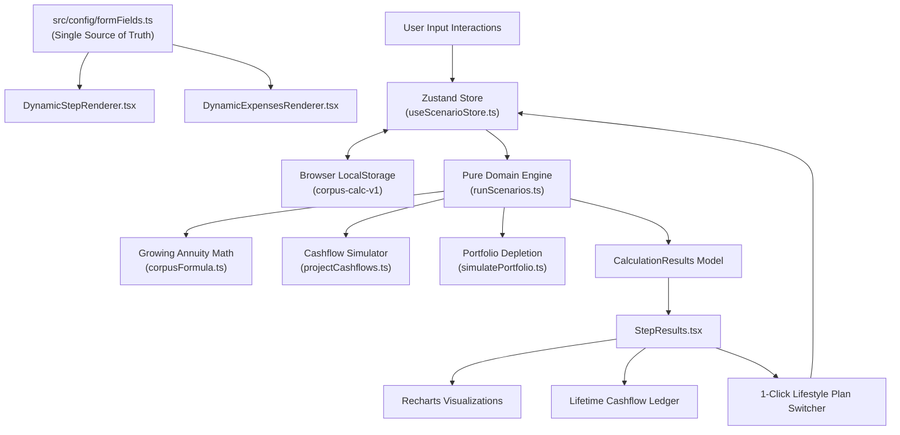

# System Architecture & Technical Overview

This document outlines the architectural philosophy, folder organization, and design patterns governing the Lifetime Cost & Corpus Calculator.

---

## Architecture Principles

The application is engineered around four core principles:

1. **Clean Separation of Concerns**: Pure domain financial math is completely isolated from React UI components. Domain calculations know nothing about the DOM, Zustand, or Recharts.
2. **Config-Driven Interface**: Rather than hardcoding forms, all wizard steps, fields, validation boundaries, default values, and help text live in a single declarative configuration file.
3. **Reactive Unidirectional Data Flow**: User edits update the Zustand state store, which triggers deterministic financial model runs and feeds reactive visual components.
4. **Zero-Backend Privacy**: 100% client-side execution using browser `localStorage`. No user financial data leaves the browser.

---

## Directory Hierarchy

```
src/
├── config/
│   └── formFields.ts              # Declarative schema for steps, fields, and default expense categories
├── domain/                        # Pure TypeScript domain layer (Zero React/UI dependencies)
│   ├── models/                    # Immutable data models & interfaces
│   │   ├── profile.ts             # Profile, AreaType, LifestyleScenario
│   │   ├── household.ts           # HouseholdMember, Relationship types
│   │   ├── assets.ts              # Income, Assets, Liabilities, LumpSums
│   │   ├── expense.ts             # ExpenseCategory, ExpenseItem, Frequencies
│   │   ├── assumptions.ts         # Inflation, Returns, ScenarioPresets
│   │   └── results.ts             # ScenarioResult, YearProjection, LifestyleComparison
│   ├── calculations/              # Pure calculation functions
│   │   ├── annualise.ts           # Frequency converters (weekly to annual, etc.)
│   │   ├── corpusFormula.ts       # Growing annuity mathematical formulations (Convention A)
│   │   ├── projectInflation.ts    # Compounding inflation trajectories
│   │   ├── projectCashflows.ts    # Year-by-year cashflow simulation
│   │   ├── simulatePortfolio.ts   # Accumulation & depletion portfolio modeling
│   │   ├── areaDefaults.ts        # Demographic & geographic default calibration
│   │   ├── runScenarios.ts        # Multi-scenario runner (Optimistic, Base, Conservative, Lifestyles)
│   │   └── __tests__/             # Automated Vitest unit tests for financial logic
│   └── validation/                # Zod schemas and planning warning generators
├── components/                    # React UI Layer
│   ├── form/                      # Config-driven inputs (DynamicField, Select, Radio, Slider)
│   ├── expenses/                  # DynamicExpensesRenderer (Category totals vs itemized toggle)
│   ├── wizard/                    # DynamicStepRenderer, WizardProgress, StepHeader
│   ├── steps/                     # StepResults (Dashboard, charts, reconciliation, print view)
│   └── ui/                        # ThemeToggle, SocialLinks, shared primitives
├── store/
│   └── useScenarioStore.ts        # Zustand state store with persistence middleware
├── lib/                           # Formatting (currency formatting in L/Cr, percentages, Tailwind cn)
├── pages/
│   ├── HomePage.tsx               # Product landing page and educational walkthrough
│   └── WizardPage.tsx             # 6-step wizard page container
├── App.tsx                        # Root routing container (Home vs Wizard)
└── main.tsx                       # Vite client entrypoint
```

---

## Component & Data Flow Diagram


